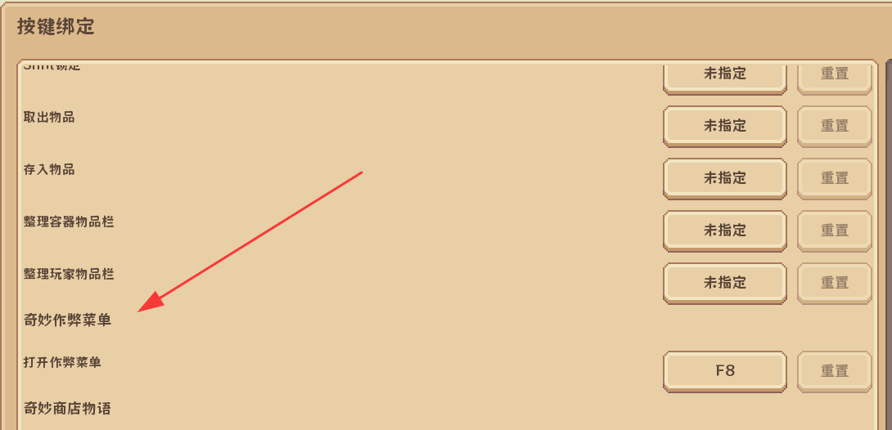

# 奇妙作弊菜单 · WSS Cheat Menu

给《奇妙商店物语》整合包做的**图形化作弊菜单**。按一下 `F8` 弹出面板，加钱、改倍率、一键解锁、改时间天气，全都点一下就好。

* Minecraft **1.21.1** / **NeoForge 21.1+**
* 纯客户端模组，**不需要**在服务端安装，**不需要**装到整合包的服务器上
* 只用核心模组自己的公开接口（`EmploymentData` / `ShopCheats`），没有 mixin，不改任何别的模组
* 单人游戏专用

---

## 目录

- [界面长什么样](#界面长什么样)
- [安装](#安装)
- [使用教程](#使用教程)
- [金钱倍率是怎么算的](#金钱倍率是怎么算的)
- [常见问题](#常见问题)
- [兼容性](#兼容性)
- [从源码构建](#从源码构建)
- [项目结构](#项目结构)
- [免责声明](#免责声明)

---

## 界面长什么样

<!-- 欢迎 PR 补充界面截图 -->


安装成功后在 `选项 → 控制 → 按键绑定` 里能搜到 **奇妙作弊菜单** 分类，默认键位 `F8`，可以随时改。

菜单本体是一个 420×248 的小窗口：

```
┌──────────────────────────────────────────────┐
│ 奇妙作弊菜单                    余额 1,234,567 │   ← 标题栏，右上角实时余额
├──────────────────────────────────────────────┤
│ [金钱] [解锁] [玩家] [世界]                   │   ← 四个页签
├──────────────────────────────────────────────┤
│ 金钱倍率     [ 倍率 ×5 ]   收益 ×N 自动补差   │
│ 快速加钱     [+1万][+10万][+100万][+1000万]  │
│ 自定义金额   [ 10000 ][增加][设为]            │
│ 自动补钱     [ 自动补钱：开 ]  低于5万补到500万│
├──────────────────────────────────────────────┤
│ 已增加 10,000　当前余额 1,244,567    [F8 关闭]│   ← 操作结果
└──────────────────────────────────────────────┘
```

## 安装

### 方式一：直接下载（推荐）

1. 到本仓库的 [`dist/`](dist/) 目录下载 `wsscheat-1.0.0.jar`（或者 Releases 里的附件）
2. 把它丢进整合包的 `mods` 文件夹：

   ```
   <你的启动器目录>\.minecraft\versions\奇妙商店物语1.6.5\mods\wsscheat-1.0.0.jar
   ```

   用 PCL2 的话：右键版本 → **打开文件夹** → 进 `mods`，粘贴进去即可。
3. 启动游戏。进主界面后看日志或直接进存档按 `F8`。

### 方式二：从源码构建

见 [从源码构建](#从源码构建)。

### 卸载

删掉 `mods\wsscheat-1.0.0.jar` 就行。不会在存档里留下任何残留数据——它只通过核心模组原有的记账接口改数据，卸载后存档照常加载。

## 使用教程

> **在游戏里（第一人称视角下）按 `F8` 打开菜单**，再按一次 `F8` 或 `Esc` 关闭。
> 注意要在**存档里**按，标题界面按是没反应的。

菜单打开时游戏**不会暂停**（这样按钮才能立刻生效），所以挂机时留意周围。

### 💰 金钱

| 控件 | 说明 |
| --- | --- |
| 右上角余额 | 每 0.5 秒刷新一次，直接读核心模组的钱包数据 |
| `+1万` `+10万` `+100万` `+1000万` | 点一下就加，底部显示结果和新余额 |
| 自定义金额 + `增加` | 输入框里填数字（只接受数字），加到当前余额上 |
| 自定义金额 + `设为` | 把余额**直接改成**这个数字 |
| `倍率 ×N` | 点一下循环切换：`×1 → ×2 → ×3 → ×5 → ×10 → ×20 → ×50 → ×100 → ×1` |
| `自动补钱` | 开关。开启后余额低于 5 万就自动补到 500 万 |

### 🔓 解锁

| 按钮 | 做了什么 |
| --- | --- |
| 一键全解锁 | 材料每种补到 64、道具每种 10 个、额外 +100,000 金币、全部菜品/配方/顾客/研究一次点亮 |
| 解锁 1 家分店 / 解锁 2 家分店 | 直接给分店名额（游戏本身只允许 1、2 这两个值） |

> 一键解锁**需要你已经拥有一家店铺**。没店铺时核心模组会拒绝，菜单底部会提示原因，不会崩。

### 🧍 玩家

| 按钮 | 说明 |
| --- | --- |
| 满血 + 满饱食 | 血量回满，饥饿值和饱和度拉满 |
| 清除所有状态效果 | 包括中毒、缓慢，也包括你自己开的夜视 |
| 夜视：开/关 | 无限时长夜视，按钮文字跟着真实状态走 |
| 飞行：开/关 | 开启后双击空格起飞（和创造模式一样） |
| 无敌：开/关 | 关闭一切伤害结算 |
| +10 经验等级 | 连点可以叠加 |

### 🌍 世界

| 按钮 | 说明 |
| --- | --- |
| 清晨 / 正午 / 黄昏 / 午夜 | 直接把时间设到 1000 / 6000 / 12000 / 18000 |
| 晴天 / 下雨 / 雷暴 | 切换主世界天气 |
| 清除周围敌对生物 | 半径 64 格内的怪物全部移除 |

## 金钱倍率是怎么算的

**它不是一个全局伤害/收益乘数，而是「补差价」**：每 0.25 秒（5 tick）检查一次余额，只要余额比上次多（说明这段时间真的赚到钱了），就按

```
补的钱 = 这段时间的净收入 × (倍率 - 1)
```

再补一笔进去。于是设成 `×10` 时，正常营业赚 1 万，实际到手 10 万。

由此带来的几个特性，用之前最好知道：

* ✅ 只对**收入**生效，花钱不会翻倍
* ✅ 同一瞬间「又赚又花」的部分按净额算
* ✅ 用菜单手动加的钱**不会**被倍率二次放大（加了 1 秒静默期）
* ✅ 所有补的钱都走核心模组自己的记账接口，钱庄/账本流水里能看到 `作弊菜单·倍率补贴`
* ⚠️ **不追溯**已经赚到的钱，只对之后的收入生效
* ⚠️ 倍率状态存在内存里，**重开游戏会回到 ×1**（手动加的钱、解锁的东西是实打实写进存档的）

## 常见问题

**Q：按 F8 没反应？**
A：① 确认是**在存档里**按，标题界面无效；② 可能键位冲突了，去 `选项 → 控制 → 按键绑定` 搜「奇妙作弊菜单」看看是不是被别的模组占了；③ 看 `logs/latest.log` 里有没有 `[wsscheat] 奇妙作弊菜单 v1.0.0 已加载`，没有就是模组没加载。

**Q：能不能在别人开的服务器用？**
A：不能。菜单能打开，但底部会提示「仅支持单人游戏：当前没有本地集成服务器」，并且不会改任何数据。因为这个模组是直接操作**本机内置服务端**的存档，服务器上做不到。

**Q：加钱失败 / 余额没变？**
A：核心模组会拦截超过上限的金额，以及会花掉「已预留资金」的扣款。底部提示会说明是哪种情况。

**Q：一键解锁提示失败？**
A：需要先有自己的店铺（进过自己的店）。另外如果材料仓库满了，核心模组也会拒绝。

**Q：会让存档坏掉吗？**
A：不会写坏存档，所有改动都走核心模组原本的 `SavedData` 接口。但作弊改出来的数据是不可逆的——**建议先用备份存档或者开个新档玩**。

**Q：和其他模组冲突吗？**
A：纯客户端、零 mixin、只调核心模组的公开方法，理论上不冲突。如果有问题，删掉本模组即可。

## 兼容性

| 项目 | 版本 |
| --- | --- |
| Minecraft | 1.21.1 |
| NeoForge | 21.1.x（在 21.1.251 上编译） |
| 核心模组 `wonder_shop_story_core` | 1.6.x（在 1.6.5 上编译） |
| 端 | 客户端（单人游戏） |

## 从源码构建

需要 **JDK 21+**（游戏本体是 Java 21 编的，编译产物也是 21）。不需要 Gradle、不需要联网——直接拿你本地已经下好的库当 classpath 编译。

```powershell
git clone https://github.com/youyenben/wss-cheat-menu.git
cd wss-cheat-menu
powershell -NoProfile -ExecutionPolicy Bypass -File .\build.ps1
```

产物：`dist\wsscheat-1.0.0.jar`

脚本会自动找：

* 整合包目录（默认依次尝试 `%APPDATA%\.minecraft`、`D:\pcl mc\.minecraft`、`C:\pcl mc\.minecraft`）
* 里面的 `versions\*1.6.5*\mods\wonder_shop_story_core*.jar`
* JDK（`JAVA_HOME` → `C:\Program Files\Eclipse Adoptium\*` → `C:\Program Files\Java\*`）

找不到时手动指定：

```powershell
.\build.ps1 -MinecraftDir "D:\pcl mc\.minecraft" -Jdk "C:\Program Files\Java\jdk-21" -Out ".\dist\wsscheat-1.0.0.jar"
```

> 首次构建需要整合包**至少启动过一次**，这样 `libraries\` 里才有 NeoForge 的核心库和官方映射的客户端 jar。

## 项目结构

```
wss-cheat-menu/
├─ src/wsscheat/
│  ├─ WssCheats.java           模组入口（@Mod，注册按键/事件，异常兜底）
│  ├─ CheatServer.java         全部作弊逻辑：金钱、解锁、玩家、世界、倍率调度
│  └─ client/
│     ├─ CheatScreen.java      图形界面（4 个页签、输入框、状态栏）
│     ├─ CheatBridge.java      客户端 → 集成服务端线程的调用桥
│     └─ ClientSetup.java      F8 按键注册
├─ res/
│  ├─ META-INF/neoforge.mods.toml   模组元数据
│  └─ assets/wsscheat/lang/*.json   按键名称翻译（简中/英文）
├─ docs/images/                 文档图片
├─ dist/                        构建好的 jar
└─ build.ps1                    一键编译打包
```

**架构说明**：单人游戏时客户端和内置服务端在同一个 JVM 里。菜单通过 `IntegratedServer.execute(...)` 把动作排到服务端线程，直接调用核心模组的方法——所以不需要自定义网络包，也不需要 mixin。核心用到的三个接口：

```java
EmploymentData.get(server).balance(uuid);                        // 读余额
EmploymentData.get(server).changeBalance(uuid, amount, reason);  // 加/减钱
ShopCheats.grant(player);                                        // 一键解锁
```

## 免责声明

* 本项目是**第三方非官方**模组，与《奇妙商店物语》原作者无关，不包含核心模组的任何代码或资源。
* 仅建议用于**自己的单人存档**。改坏了自己的存档请自行负责，动手前先备份。
* 请勿用于多人服务器、破坏他人游戏体验或任何商业用途。

## License

[MIT](LICENSE)

---

## English

**WSS Cheat Menu** — an in-game GUI cheat menu for the *Wonder Shop Story* (奇妙商店物语) Minecraft 1.21.1 / NeoForge modpack.

* Press **F8** in-game (first person) to open; rebindable in Options → Controls → Key Binds.
* Money: live balance, quick add (+10k … +10M), custom amount, set exact value, income multiplier ×1–×100, auto top-up.
* Unlocks: one-click unlock of ingredients/props/dishes/customers/research, branch permits.
* Player: heal, clear effects, night vision, fly, invulnerable, +10 levels.
* World: time of day, weather, clear hostile mobs.
* Client-side only, singleplayer only. No mixin, no bytecode patching — it calls the core mod's own public API (`EmploymentData`, `ShopCheats`) on the integrated server thread.

Build: `powershell -ExecutionPolicy Bypass -File .\build.ps1` (needs JDK 21+ and a local copy of the modpack).
